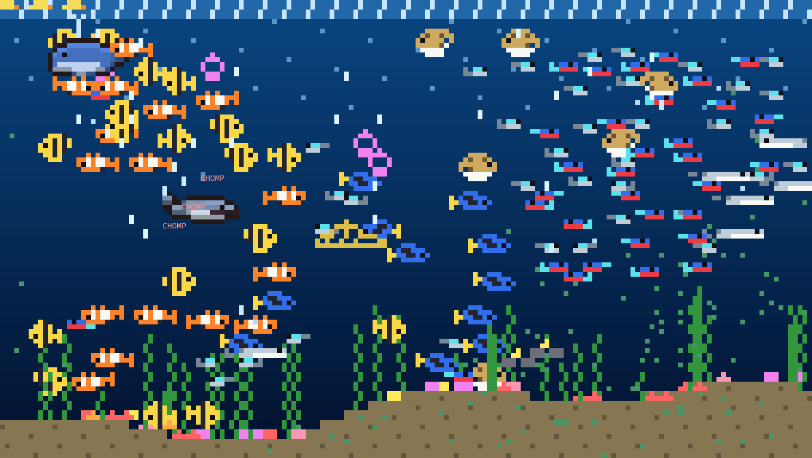
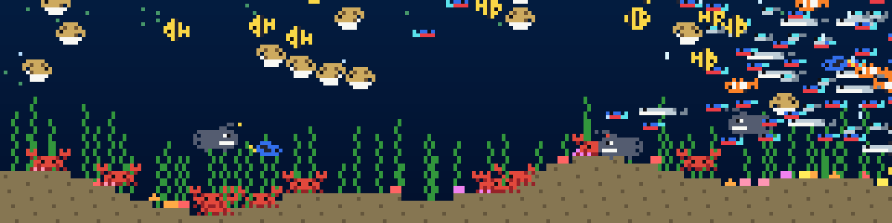
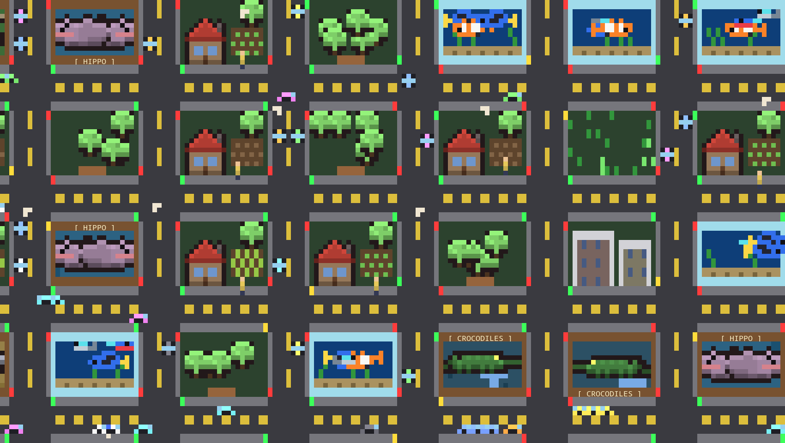
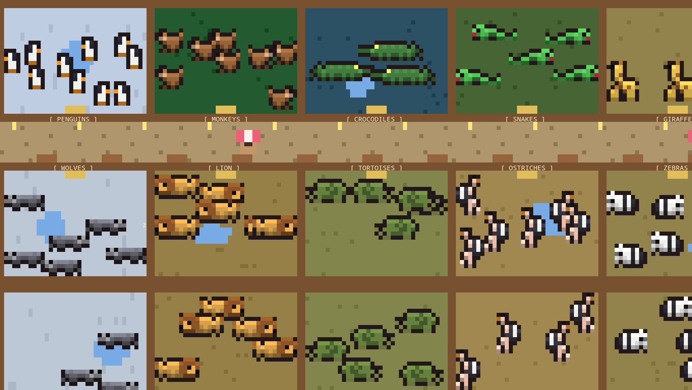
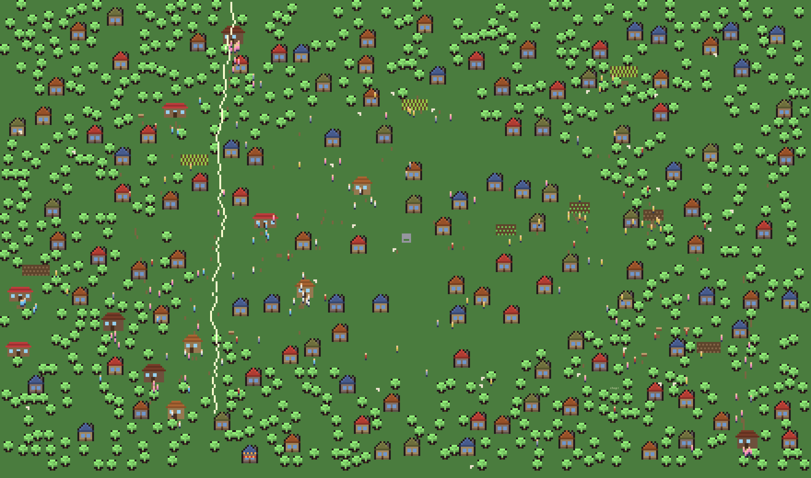
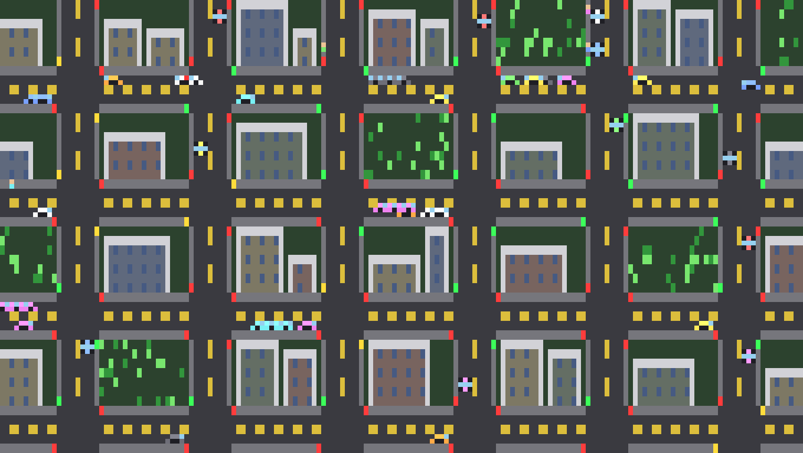
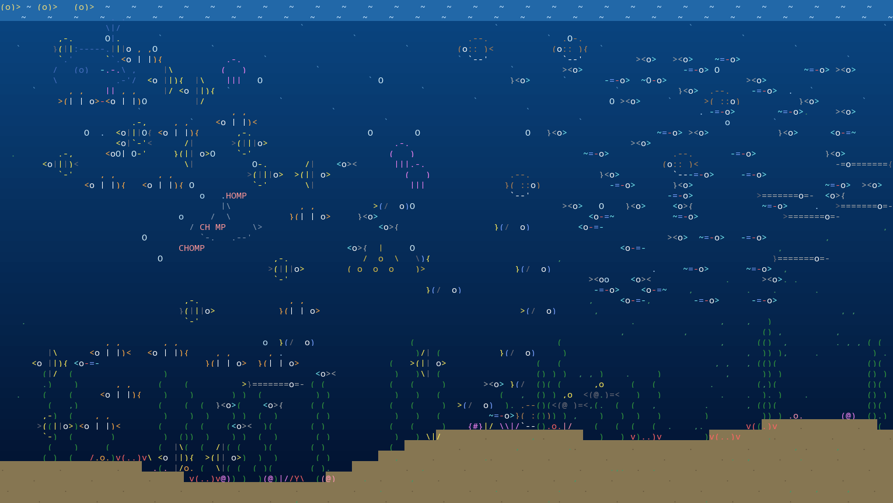

# ascii-zoo

Whole living worlds in your terminal. It started as "asciiquarium, but to the 100th power" and became a small Rust and [ratatui](https://ratatui.rs) simulation engine with five worlds: an aquarium, a zoo, a village, a traffic grid and a city that mixes them all.

Everything runs on its own. Sharks hunt, fish scatter and hide in the kelp, lions escape, houses burn and tow trucks clear wrecks. A news ticker tells you what just happened, and you can click any creature to read its bio. Or press `a` and add a shark yourself.



## The worlds

### Aquarium

A food chain. Sunlight grows plankton, schools of fish flock, graze, breed and starve, and sharks turn up when fish are plentiful. Fish flee on sight, panic spreads through a school, and small fish dive into the kelp. Anglerfish roam the deep and ambush whatever swims too close. Ships sink and leave treasure wrecks that divers raid.



### City

Every block is a diorama (zoo pen, fish tank, farmstead, park) between signalised roads with cars, pedestrians and emergency vehicles.



### Zoo

Herds get hungry and eat from troughs, and keepers go wherever food runs low. Babies are born and follow their mothers. Animals escape through gaps or lightning strikes, visitors panic, predators stalk them and rangers bring them home. Daily parades and reputation decide how many people come.



### Village

Villagers are born, work, grow up into a trade and die. Woodcutters fell trees that regrow, lumber builds houses, and caravans trade lumber for grain. Winter brings famine and wolves, guards chase the wolves off, and everybody runs to fight house fires. Footpaths wear into the grass where people walk, and autumn has a festival.



### Traffic

Two rush hours a day, buses with stops, rain that slows cars and causes crashes, tow trucks that clear the wrecks, and honking.



## Running it

```
cargo run --release                                # aquarium, fitted to your terminal
cargo run --release -- zoo                         # or traffic, village, city
cargo run --release -- city --world 600x200        # a world bigger than the screen
```

It starts in half-block pixel art when the terminal advertises 24-bit color and a UTF-8 locale, otherwise in ASCII. `--pixel` and `--ascii` override that, and `m` switches while it runs. The same aquarium as text:



## Keys

| Key | Action |
|---|---|
| `tab`, `1`-`6` | switch world |
| `a` | add things: pick a number, then click to place more |
| click, `f` | inspect a creature, follow it |
| arrows, drag | pan |
| `z`, `x`, wheel | zoom |
| `g` | fit the whole world |
| `c` | director camera |
| `j` | jump to the latest news |
| `l`, `n` | news log, minimap |
| `m` | ASCII or pixel rendering |
| `v` | 3D view |
| `,` `.` and `;` `'` | orbit and tilt the 3D camera |
| `+`, `-`, `t` | change speed, turbo (uses all CPU) |
| `space`, `r` | pause, reset |
| `?`, `q` | help, quit |

## Under the hood

Updates run in parallel with rayon and stay deterministic: the same seed gives the same world on any thread count.

- **Sprite**: multi-line art, optional color mask, animation frames, pixel art, auto-mirroring for left and right facing.
- **Entity**: position, velocity, z-depth, animation, hitbox, lifetime, `die_offscreen`, `follow` for compound objects.
- **Behavior**: `update`, `on_collide` (with `wants_collisions`), `on_death` and `describe` hooks. Neighbors are seen through a per-tick spatial snapshot (`cx.snap`).
- **Scenario**: `setup` populates the world, `tick` spawns life over time, with an optional day and night cycle. `cx.news(text, pos)` publishes a headline to the ticker.

To add a world, implement `Scenario` in `src/scenarios/mything.rs` and register it in `src/scenarios/mod.rs`. Implement `tools` and `place` to fill its add menu.

## 3D view

Press `v` to see the running world in perspective, as pixels or as text. The simulation itself stays flat, so the view changes nothing about what happens. Ground worlds stand their sprites on the map and raise buildings into blocks. The aquarium becomes a tank, with each creature at its own fixed depth, so a shark can catch a fish that looks some way off.

## Tooling

```
cargo run --release -- --dump zoo 30 120 40        # headless: print one frame after 30s
cargo run --release -- --bench city 60 600 200     # simulation and drawing speed
python3 tools/screenshots.py                       # regenerate the images here (needs Pillow)
```

`WORLD=WxH`, `VIEW=x,y,zoom`, `PIXEL=1`, `CAM3D=yaw,pitch`, `SEED=n` and `OUT=cells.txt` tune `--dump`, and `tools/render.py cells.txt out.png` turns a cell dump into an image. The screenshots are real frames made this way, so they leave out the status bar and overlays.
